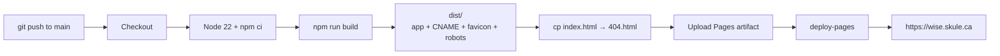

# WISE UofT Website

React + Vite + TypeScript + Tailwind CSS website for Women in Science and Engineering, University of Toronto.

- Live site: https://wise.skule.ca
- Repository: https://github.com/WISE-UofT/wise-main

The previous static HTML site is kept in [`archived/`](archived/) for reference. It is **not deployed** — only the production build in `dist/` is published.

## Running the code

Requires **Node.js 22 LTS** (matches CI) and npm.

```bash
npm ci          # install dependencies from the lockfile
npm run dev     # start the development server
npm run build   # create a production build in dist/
npx vite preview  # serve the build locally
```

## Project structure

```text
wise-main/
├── .github/
│   └── workflows/
│       └── deploy.yml            # build + deploy to GitHub Pages
├── public/                       # copied into dist/
│   ├── CNAME                     # wise.skule.ca
│   ├── favicon.jpg
│   └── robots.txt
├── src/
│   ├── app/
│   │   └── App.tsx               # BrowserRouter + routes
│   ├── components/
│   │   ├── Nav.tsx
│   │   ├── TeamCards.tsx
│   │   └── ui/                   # cards, marquee, counters, photo stack
│   ├── data/
│   │   ├── assets.ts             # image re-exports
│   │   ├── content.ts            # ALL site text, names, events, sponsors
│   │   └── teamPhotos.ts         # portrait filename lookup
│   ├── imports/                  # images bundled by Vite
│   │   └── team/                 # member portraits
│   ├── pages/                    # one file per route
│   │   ├── HomePage.tsx
│   │   ├── OurTeamPage.tsx
│   │   ├── OurSponsorsPage.tsx
│   │   ├── EventsPage.tsx
│   │   ├── InitiativesPage.tsx
│   │   ├── ConferencePage.tsx
│   │   └── StoriesPage.tsx
│   ├── styles/                   # fonts, theme, Tailwind, global CSS
│   ├── main.tsx                  # React root
│   └── ...
├── archived/                     # legacy static site (NOT deployed)
├── index.html                    # app entry + meta tags
├── package.json
├── package-lock.json
├── vite.config.ts                # aliases, Tailwind, plugins
├── dist/                         # build output (git-ignored)
└── README.md
```

## Where things live

- **All text content** — `src/data/content.ts`. Names, roles, quotes, events, sponsors, initiatives, gallery captions. Edit here, not in the page files.
- **Team portraits** — drop the file into `src/imports/team/`, then set `photo: "filename.jpg"` on that person in `content.ts`. `teamPhotos.ts` resolves it by filename and falls back to a placeholder when empty. Use `firstname_lastname.jpg`.
- **Other Images** — import  through `src/data/assets.ts`.
- **New page** — add a component in `src/pages/`, then a `<Route>` in `src/app/App.tsx`.
- **Styles** — Tailwind entry point is `src/styles/tailwind.css`; theme tokens live in `src/styles/theme.css`.

## How code becomes the live site

The workflow runs only on pushes to `main` (or manually via `workflow_dispatch` once the file exists on `main`).



## Contribution Guide

_If you are **not** a part of the WISE executive team and would like to propose contributions, we'd love to hear from you! While this is a club and not an open-source project, we welcome ideas and contributions from anyone interested._

### Pre-requisites

Install [Node.js 22 LTS](https://nodejs.org/) and npm. [Visual Studio Code](https://code.visualstudio.com/) is recommended but optional.

### Create and develop on a fork of `wise-main`

1. Fork the `wise-main` repository.
2. Go to your forked repository and clone it to your local machine.
3. Run `npm ci`, then `npm run dev`.
4. Create a new branch with your changes and complete your changes.
5. Push your branch to your **forked** repository.

### Opening a pull request to the original `wise-main` repository

1. Go to your **forked** repository on GitHub.
2. With the new changes pushed, go to the "Pull Requests" tab and click "New Pull Request".
3. In the `base repository` dropdown, select `WISE-UofT/wise-main`. In the `base` dropdown, select the branch you want to merge into, usually `main`.
4. In the `head repository` dropdown, select your forked repository. In the `compare` dropdown, select the branch you just pushed.
5. Select **Allow edits by maintainers**.
6. Add a title and description, then click "Create Pull Request".

### Wait for approval

The VP of Marketing can now see this PR in the original `wise-main` repository under the "Pull Requests" tab.

Merging to `main` deploys to production automatically, so changes are reviewed before merge.

### Notes for maintainers

- Never commit `node_modules/` or `dist/`; both are ignored.
- Never add a `CNAME` to a test branch — it would claim the production domain (`wise.skule.ca`).

